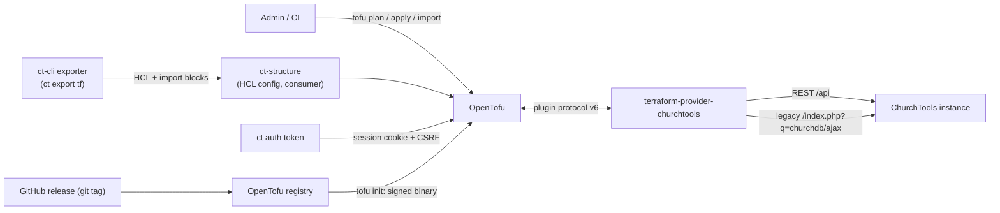

# 3. Context and scope

## Business context

| Partner | Exchange |
|---|---|
| ChurchTools | The system under management (REST and legacy endpoint). |
| OpenTofu / Terraform | Hosts the provider as a plugin process. |
| `ct-cli` | `ct export tf` renders HCL and `import` blocks from its state; `ct auth token` supplies a session. |
| `ct-structure` | Private consumer: the HCL configuration, CI plan/apply, `prevent_destroy` on every generated resource. |
| OpenTofu registry | Distribution; serves the assets of a GitHub release verbatim. |

## Technical context

| Channel | Protocol | Notes |
|---|---|---|
| Provider to ChurchTools REST | HTTPS JSON, `/api/...`, `{"data": ...}` envelope | Token: `Authorization: Login <token>`. Session: `Cookie` plus `CSRF-Token` on writes. |
| Provider to legacy endpoint | HTTPS, form-encoded POST to `/index.php?q=churchdb/ajax` | Needs cookie plus CSRF token; failure is HTTP 200 with `{"status":"error"}`. |
| OpenTofu to provider | gRPC plugin protocol v6 | Local process. |

Out of scope: people, memberships, participants (never touched).
