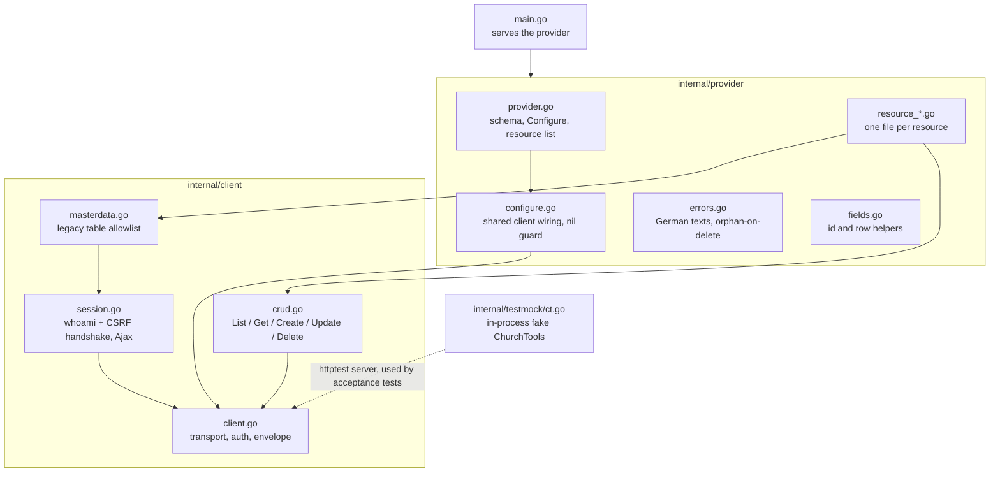

# 5. Building block view

## Level 1

| Block | Responsibility |
|---|---|
| `internal/provider` | Provider schema (`host`, `token`, `session_cookie`, `csrf_token`, `max_requests_per_second`), validation, resources. One shared `*client.Client` is passed to all resources via `ProviderData`, because the framework creates a fresh resource per RPC and would otherwise lose the legacy session. |
| `internal/client` | Untyped REST transport (`Row = map[string]any`), pagination, 401 handling, legacy session and master-data writes. |
| `internal/testmock` | HTTP fake with a verb allowlist per collection; seeds rows by id. |
| `testdata/` | Synthetic ct-cli state files for the golden tests. |

## Level 2: resources

All types are prefixed `churchtools_`. The authoritative list is `Resources()` in
`internal/provider/provider.go`. There are no data sources.

| Type | Path | Write path |
|---|---|---|
| `campus` | `/campuses` | REST, PUT |
| `group_type` | `/group/grouptypes` | REST, PUT |
| `person_status` | `/statuses` | REST, PUT |
| `comment_viewer` | `/person/commentviewers` | REST, PUT |
| `contact_label` | `/contactlabels` | REST, PUT |
| `relationship_type` | `/person/relationshiptypes` | REST, PUT |
| `target_group`, `age_group` | `/group/targetgroups`, `/group/agegroups` | REST, PUT answers 204 without a body |
| `group_category` | `/group/groupcategories` | REST, PUT |
| `db_field` | `/dbfields/{id}` | REST, import-only; Update GETs, then PUTs the full body ([README](../../README.md#what-is-verified-and-what-is-not)) |
| `department` | read `/departments` | Legacy master data, table `cdb_bereich` |
| `privacy_agreement_type` | read via `getMasterData` | Legacy master data, table `cdb_privacy_policy_agreement_types` |
| `privacy_agreement_who` | read via `getMasterData` | None: import-only, built-in rows, kept off the write allowlist |
| `group` | `/groups` | REST, POST + PATCH of the changed fields only; reads its ids from `information`, writes them flat; Update reads the group back and fails if CT ignored a field |
