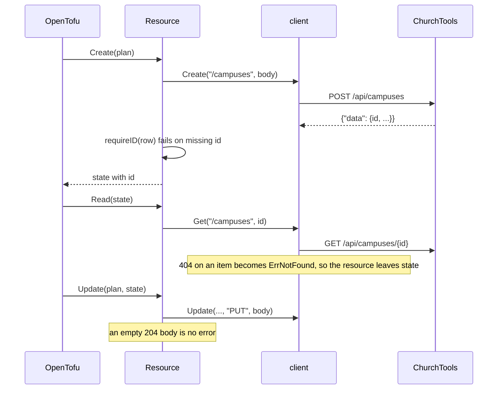
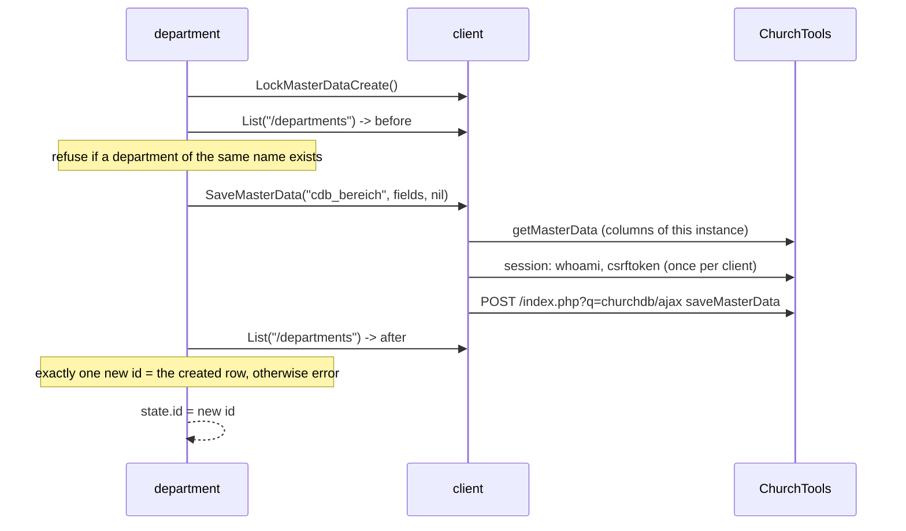

# 6. Runtime view

## REST resource (e.g. campus)

An empty id is refused (`ErrNoID`) because `GET /campuses/` would address the
whole collection. A 404 on a *collection* path is a plain error, never
`ErrNotFound`: it means the endpoint doesn't exist.

## Legacy master-data resource (department)

There is no `GET /departments/{id}`, and the write returns no id.

The lock exists because Terraform creates independent resources in parallel and
two interleaved snapshot-diff sequences could not claim their rows. Update is the
same `saveMasterData` call with the row id set; Read filters the list.

## Import and no-op plan

1. `import { to = churchtools_x.name, id = "<numeric id>" }`; `ImportState` passes the id through.
2. Read fills every attribute from ChurchTools.
3. The configuration is compared with that state; an empty plan is the acceptance criterion.

`TestGolden_*` in `internal/provider/golden_test.go` automates this: it seeds
the mock from a synthetic ct-cli state file, generates HCL the way the exporter
does, imports every row and asserts an empty plan, including a row with id 0.
Its attribute mapping must stay identical to the exporter's.

## Delete

`Delete` adds the warning "Objekt bleibt in ChurchTools bestehen" and returns;
no request is sent.
