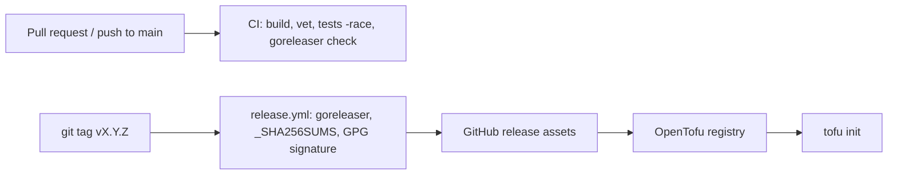

# 7. Deployment view

The provider is a single Go binary run by OpenTofu on the operator's machine or
a CI runner. There is no server component.

## CI (`.github/workflows/ci.yml`)

- `go build ./...`, `go vet ./...`, `TF_ACC=1 go test ./... -v -race`; a real `terraform` binary is installed once for the acceptance tests.
- `goreleaser check` validates the release config, because only a tag would otherwise exercise it.
- Markdown-only changes skip CI. `gofmt -l .` is not part of CI; run it locally.
- Superseded PR runs are cancelled; pushes to `main` are not.

## Release

A `vX.Y.Z` tag triggers `release.yml`. **A tag is a publication**: a published
version can't be taken back, the registry takes roughly 20 to 30 minutes to
serve it, and merging a PR is not a release. Tag only on explicit decision, and
check first whether the consumer repo is already cutting the release.

Prerequisites (signing key, key registered for the namespace, registry submission)
are in the [README](../../README.md#releasing).

## Local

A dev override in `~/.tofurc` points at a locally built binary; see the README.
